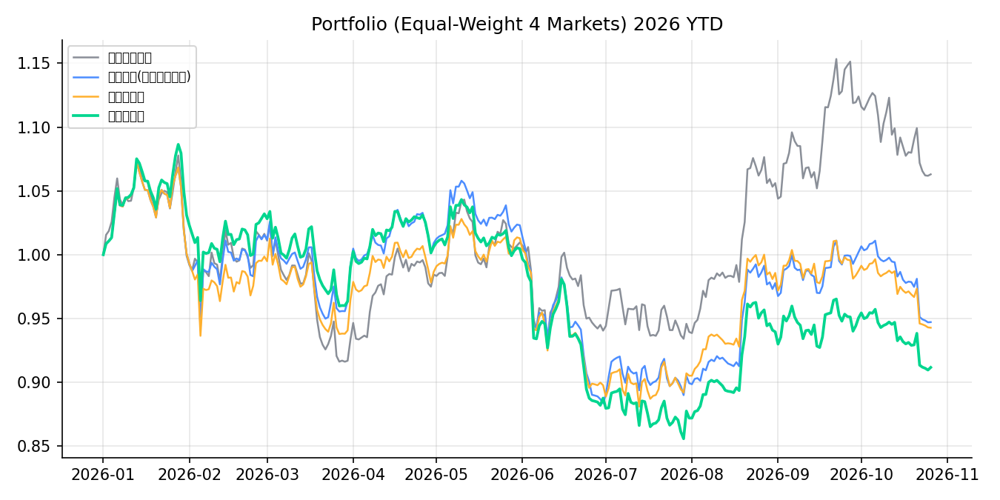
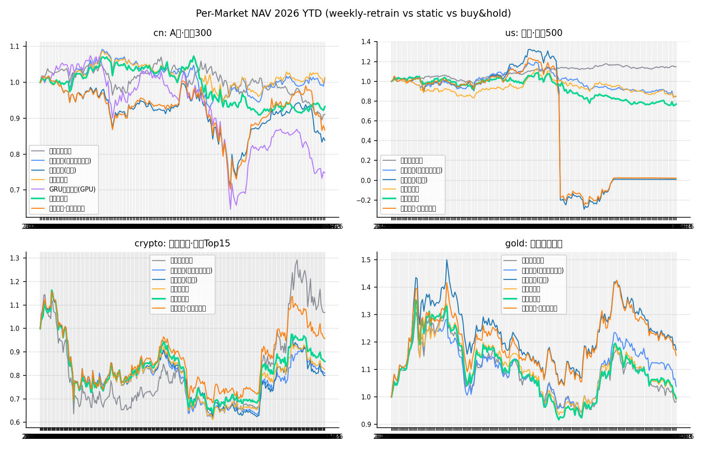

# OpenTrade · 开源量化模型四市场实盘模拟实验

> 用 **Microsoft Qlib(Alpha158 + LightGBM/GRU)** 在 **A股·美股·加密·黄金** 四类市场回测 **2026 年初至今**的每周调仓交易,并检验一个假设:
> **每周用最新数据重新训练模型,能否比"年初训练一次"赚到更多?**

**[🌐 在线展示(GitHub Pages)](https://holidayrabbit.github.io/OpenTrade/)** · **[📦 本仓库](https://github.com/Holidayrabbit/OpenTrade)** · 实验代号:alpha2026 · 引擎部署:RTX 3060 · WSL2

[](https://github.com/Holidayrabbit/OpenTrade/actions/workflows/weekly-refresh.yml)

> **本项目是活的**:自托管 GitHub Actions runner(部署在 RTX 3060/WSL2 机器上)会在**每周一 08:30(北京时间)自动重跑全流程**——增量抓取四市场最新数据、重训模型、重算回测、重建站点并推送,GitHub Pages 随之更新。页面上"生成于"时间即最近一次刷新。也可在 Actions 页面手动触发(workflow_dispatch)。

---

## 一句话结论

**不支持(组合层面)。** 2026 年初至今,四市场等权组合:买入持有 **+8.5%** > 静态模型 **+0.6%** > 每月再训练 **-1.0%** > 每周再训练 **-2.5%**。每周重训相对静态 **-3.1pp**——"每周调整模型"并没有无条件提高收益率,但**因市场而异**:黄金(+5.9pp)与美股(+7.2pp)显著受益,而 A股(-12.0pp)与加密(-10.4pp)明显受损。与此同时,模型本身是有效的:A股静态模型跑赢买入持有 7.2pp、黄金跑赢 8.7pp,IC 复现出 Qlib 官方基准水平(0.039 vs 0.045)。

## 结果总览(2026-01-01 → 2026-10-25,周度调仓,含交易成本)

| 市场 | 等权买入持有 | 静态模型 | 每月再训练 | 每周再训练 | GRU静态(GPU) |
|---|---|---|---|---|---|
| A股·沪深300 | -9.0% | **-1.8%** | -0.6% | -13.8% | -23.6% |
| 美股·标普500 | **+14.7%** | -2.0% | -17.3% | +5.2% | – |
| 加密·币安Top15 | **+15.8%** | -11.3% | -6.9% | -21.6% | – |
| 黄金资产组合 | -1.0% | +7.7% | +10.9% | **+13.6%** | – |
| **四市场等权组合** | **+8.5%** | +0.6% | -1.0% | -2.5% | – |

三个关键发现:
1. **模型新鲜度不是免费午餐**:再训练提升了预测质量(A股 IC 0.0385→0.0412,黄金 -0.017→+0.019),但组合收益不一定同步改善——在窄横截面(加密15标的)、单边弱市(A股2026)里,周度重训会放大对"近期强势股"的追逐,回撤反而加深;在轮动明显、标的性质异质的市场(黄金跨现货/期货/ETF/矿股、美股)里,新鲜度才转化为收益。
2. **市场有效性决定 Alpha158 价值**:A股/黄金(相对无效)模型显著跑赢基准;美股(IC≈0.004)与加密(高噪声)价量因子全面失效,2026 年这两个市场里"什么都不做"反而是最优策略。
3. **LightGBM ≫ GRU**:A股静态 IC 0.0385 vs 0.011,收益 -1.8% vs -23.6%,与 Qlib 官方 benchmark 结论一致(树模型在 Alpha158 上是最强基线,深度模型需要 Alpha360 这类原始序列输入)。




## 1. 调研:为什么选这些开源项目(2025-2026)

| 项目 | 定位 | 活跃度 | 本实验中的角色 |
|---|---|---|---|
| **[Microsoft Qlib](https://github.com/microsoft/qlib)** | AI 量化研究平台(因子/模型/回测一体化) | 49k+ ★, v0.9.8(2026-10) | **✅ 选型**:Alpha158 因子 + LightGBM 基准 + GRU 深度模型 + walk-forward 范式全部直接复用 |
| [FinRL](https://github.com/AI4Finance-Foundation/FinRL) | 深度强化学习交易框架 | 14k+ ★ | 调研对照(研究导向,实盘门槛高) |
| [Freqtrade / FreqAI](https://www.freqtrade.io/) | 加密实盘机器人,原生周期性再训练 | 35k+ ★ | 调研对照(加密单市场;"周期再训练"理念与本文 weekly 实验同源) |
| [vn.py](https://github.com/vnpy/vnpy) | A股/期货/期权中文实盘生态 | 25k+ ★ | 调研对照(实盘接口强,ML 研究弱) |
| [NautilusTrader](https://github.com/nautechsystems/nautilus_trader) | Rust 内核事件驱动回测/实盘 | 30k+ ★ | 调研对照(生产级撮合,重后端) |
| [QuantConnect Lean](https://github.com/QuantConnect/Lean) | 机构级多资产平台 | 22k+ ★ | 调研对照(C#/机构向) |
| backtrader / Zipline | 老牌回测库 | 基本停更/维护缓慢 | 排除 |

**关键对标数据(Qlib 官方 benchmark, CSI300 / Alpha158 / LightGBM):IC 0.0448, 年化超额 9.01%** —— 本实验 A股静态模型复现出 IC 0.0385,同量级,证明管线复现有效。

**2025-2026 前沿方向**(值得跟进):微软 [RD-Agent](https://github.com/microsoft/RD-Agent)(LLM 自动因子-模型协同优化, NeurIPS 2025)、Chain-of-Alpha(arXiv 2508.06312, LLM 公式化 Alpha 挖掘)、AI in Quant Finance 综述(arXiv 2503.21422)。

## 2. 实验设计

### 数据(全部免费公开接口,国内网络可达)

| 市场 | 标的池 | 数据源 | 2017→2026 全量 |
|---|---|---|---|
| A股 | 沪深300 成分股(300只,前复权) | 腾讯行情 fqkline | ✅ |
| 美股 | 标普500 成分股(503只,前复权) | 腾讯 usfqkline + smartbox 代码映射 | ✅ |
| 加密 | 币安 USDT 24h 成交额 Top15(按上市≥2024-06 过滤) | data-api.binance.vision | ✅ |
| 黄金 | 伦敦金XAU·COMEX·上金所Au99.99·3只黄金ETF·GLD/IAU/GDX/NEM/巴里克·4只A股金矿(14标的) | 新浪/东财/上金所(akshare)/腾讯 | ✅ |

### 模型与交易

- **特征**:Qlib **Alpha158**(158 个价量因子;归一化统计冻结在 2017-2023,防泄漏)
- **标签**:`Ref($close,-2)/Ref($close,-1)-1`(T+1→T+2 收益,与 Qlib 官方一致)
- **模型**:LightGBM(官方 CSI300 调参)+ GRU(GPU, A股对照)
- **交易**:每周首个交易日调仓,Top-K 等权(A股/美股 K=8,加密/黄金 K=5);T 日收盘出信号、T 日收盘价成交(与 Qlib 默认回测一致);成本 A股买0.08%/卖0.13%(含印花税),美股 0.05%,加密 0.1%;连续 5 日无行情强制平仓
- **对照**:①等权买入持有 ②静态(年初训练一次) ③每月再训练 ④**每周再训练**;再训练用扩展窗口+末 15% 验证早停,严格无前视

### 四个对照变体的唯一差异

| 变体 | 训练频率 | 检验什么 |
|---|---|---|
| static | 仅 2026-01-02 一次(数据截止 2025-12-31) | 传统"年度再平衡"模型 |
| monthly | 每月首个交易日 | 中频更新 |
| weekly | 每周首个交易日 | **核心假设:模型新鲜度** |

## 3. 复现(一键)

```bash
# 任何有 Python3.10+/miniconda 的 Linux/WSL 机器
bash deploy/setup_env.sh          # 建 conda env: quant, 装依赖(国内走清华镜像)
nohup bash run_all.sh > run_all.log 2>&1 &   # 抓数据→qlib落地→四市场回测→生成站点
# 过程: 数据抓取 ~10min, 回测 cn/us 各 ~1h(16核), 总计 2-4h
python -m http.server -d docs 8000            # 本地预览 http://localhost:8000
```

远程部署机(本实验实际环境:win3060wsl, RTX3060, WSL2):

```bash
bash deploy/remote_sync.sh run      # 同步代码并远程启动
bash deploy/remote_sync.sh status   # 看进度
bash deploy/remote_sync.sh fetch    # 回收 results/ 与 docs/
```

单步执行:

```bash
python scripts/01_fetch_data.py --markets cn,us,crypto,gold   # 数据(带缓存,可断点续抓)
python scripts/02_dump_qlib.py cn,us,crypto,gold              # 落地为 Qlib 二进制(独立日历)
python scripts/03_run_experiments.py --market cn --model lgbm --variants buyhold,static,monthly,weekly
python scripts/03_run_experiments.py --market cn --model gru --variants static   # GPU 对照
python scripts/04_build_site.py                               # 生成 docs/(前端数据+图)
```

### 发布到 GitHub Pages

本仓库已配置:push 到 `main` 后,Pages 从 `/docs` 目录自动发布,地址即
<https://holidayrabbit.github.io/OpenTrade/>。若在自己的仓库复刻,执行:

```bash
git init && git add -A && git commit -m "OpenTrade results"
git remote add origin git@github.com:<你的用户名>/<你的仓库>.git && git push -u origin main
# 仓库 Settings → Pages → Branch: main / Folder: /docs → Save
```

`docs/` 已含 `.nojekyll`,所有数据为纯静态 JSON,Pages 直接可用。

## 4. 项目结构

```
alpha2026/
├── configs/markets.yaml        # 四市场标的池/成本/TopK 配置
├── scripts/
│   ├── 01_fetch_data.py        # 四市场免费数据抓取(缓存+断点+多源容灾)
│   ├── 02_dump_qlib.py         # Qlib dump_bin 落地(vendored 官方脚本)
│   ├── 03_run_experiments.py   # walk-forward 回测: buyhold/static/monthly/weekly + GRU
│   └── 04_build_site.py        # 聚合 → docs/data/*.json + PNG
├── deploy/                     # 部署机环境/远程同步脚本
├── docs/                       # GitHub Pages 静态站(ECharts, 纯前端)
└── results/                    # 净值/交易/IC/refit 日志(JSON+CSV)
```

## 5. 局限与说明

- 成分股/币种按**当前**名单回溯 2017,存在幸存者偏差(研究演示可接受,已在站点标注)
- 收盘价成交略理想化;加密 7×24 与股市日历不同(各自独立日历+组合层等权日度再平衡)
- 前复权价格随分红整体重算(单次快照口径一致)
- **免责声明:历史回测不代表未来收益,本项目仅用于开源量化研究,不构成任何投资建议。**

## License / Credits

- 实验引擎:[Microsoft Qlib](https://github.com/microsoft/qlib)(MIT License),`scripts/vendor/dump_bin.py` 来自其官方仓库
- 数据:腾讯行情、新浪财经、上海黄金交易所(经 akshare)、Binance 公开行情镜像
